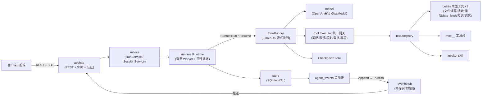
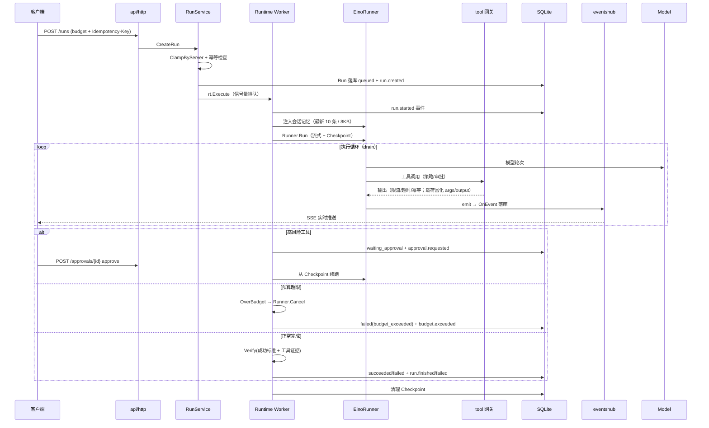

# 架构 · 总览

Rivus Agent 是**单进程** Go 服务：SQLite 持久化、有界 Worker 并发、CloudWeGo Eino ADK `v0.9.21` 驱动 Agent 执行循环。无外部中间件依赖——一个二进制 + 一个 DB 文件即是全部运行时。

## 组件图

## 分层职责

| 目录 | 职责 |
|---|---|
| `api/http` | 21 条路由（20 REST + /metrics）、SSE 流（重放 + 推送 + gap 回填）、Bearer 认证（恒时比较）、限流/安全头/X-Request-ID/访问日志中间件、owner 归属 |
| `service` | RunService（创建/取消/审批/恢复、预算收紧、幂等键）、SessionService |
| `runtime` | 有界 Worker 事件循环、预算 tracker（A-E 后强制执行）、Verifier、孤儿恢复、EinoRunner 封装（父/子 agent）、tasks 并行子代理（batch ≤5、子预算 40% 收紧）、会话记忆注入（最新 10 条/8KB） |
| `domain` | 状态机（`ValidTransition`）、事件类型（28 常量）、Budget/Approval/Run/Step 实体 |
| `tool` | Registry、统一执行网关（每次调用重新校验策略、限流、超时、审批绑定、幂等缓存、输出截断）、内置工具；tool.completed 事件携带 args/output（1KB 截断） |
| `model` | OpenAI 兼容 ChatModel 工厂，支持 Settings 表热查（3s 超时） |
| `store` | SQLite 打开/迁移、仓储（Task/Event/Approval/Checkpoint/Settings）、MemoryRepo（会话记忆 LRU 100、随会话级联删除） |
| `eventshub` | 进程内事件扇出（订阅缓冲 + 失序回填由 SSE 层兜底） |
| `skill` / `mcp` | Skill 按需加载校验（SKILL.md frontmatter + references/ 多文件 + 运行时输入注入）/ stdio MCP 服务器管理（进程组回收、就地热更新、30s 自愈 Reconciler、单次调用 30s 超时） |
| `observability` | slog 日志、expvar 指标（延迟直方图桶、事件落库失败计数） |
| `security` | 脱敏、密钥读取、租户归属校验 |
| `app` | 装配（上表全部组件）、优雅关闭（MCP StopAll → HTTP Shutdown → DB Close） |
| `buildinfo` | 版本三元组（Version/Commit/BuildDate）ldflags 注入目标，GET /version 数据源 |

## 一次 Run 的生命周期

## 关键设计决策

| 决策 | 说明 |
|---|---|
| 事件溯源 | `agent_events` 追加表是唯一事实源：SSE 重放、审计、预算用量展示都读它 |
| 统一执行网关 | 所有工具调用（含 MCP/Skill）走同一 `Executor`：权限每次重校验、限流、超时、审批绑定、幂等缓存、输出截断 |
| Checkpoint 中断恢复 | Eino 执行状态持久化 SQLite；进程重启后孤儿 Run 标记失败，可手动 resume 续跑 |
| 预算只紧不松 | 服务端上限收敛客户端申请；执行期事件循环每步强制检查（见 [状态机](state-machine.md)） |
| 有界 Worker | `WORKER_CONCURRENCY` 信号量限制并发；`waiting_approval` 不占 Worker 名额 |
| 幂等键 | `Idempotency-Key` 同 key 返回同一 Run，防重复提交 |
| 多租户 | `X-Owner-ID` 归属校验，跨 owner 一律 404 不泄露存在性 |
| 限流默认关闭 | `AGENT_RATE_LIMIT_RPM=0`（默认）不启用；开启后按 X-Owner-ID 或来源 IP 分桶（LRU 1024），仅作用于 `/api/v1/`，健康探测端点豁免 |
| 请求可观测 | X-Request-ID 透传/自动生成（32 位 hex），结构化访问日志记录 method/path/status/duration_ms/request_id |
| MCP 自愈 | 失败的 MCP 服务器每 30s 自动重连（Reconciler）；单次工具调用 30s 超时防卡死 |
| 载荷富化 | tool.completed 事件合并 args/output（各 1KB 截断），前端工具明细卡直接消费 |

相关文档：状态机与终止路径见 [state-machine.md](state-machine.md)；端点细节见 [`docs/api/`](../api/overview.md)。
