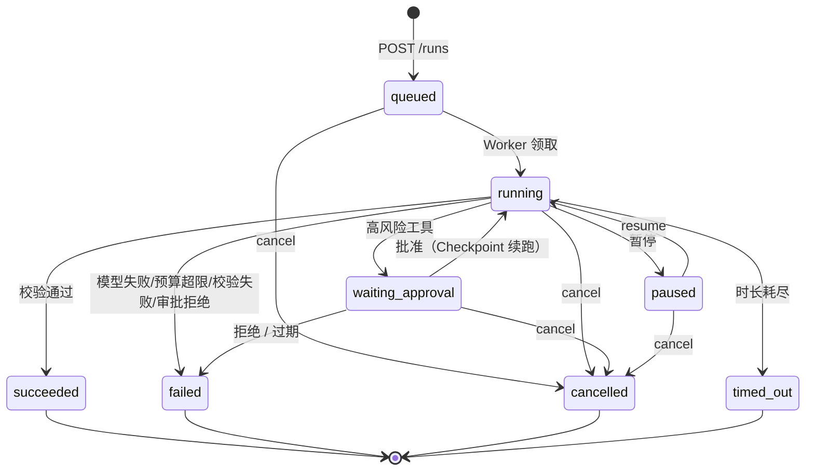

# 架构 · 状态机

Run 状态机的权威定义在 [`backend/internal/domain/task.go`](../../backend/internal/domain/task.go) 的 `ValidTransition`——文档与代码不一致时以代码为准。

## 状态总览

| 状态 | 终态 | 含义 |
|---|---|---|
| `queued` | 否 | 已创建，等待 Worker |
| `running` | 否 | 执行中（占 Worker） |
| `waiting_approval` | 否 | 高风险工具待人工审批（**不占 Worker**） |
| `paused` | 否 | 暂停（手动 resume 恢复） |
| `succeeded` | 是 | 校验通过 |
| `failed` | 是 | 失败（多种 `error_code`，见下） |
| `cancelled` | 是 | 客户端取消 |
| `timed_out` | 是 | 预算时长耗尽 |

## 迁移图

## 迁移表

| from | to | 触发者 |
|---|---|---|
| `queued` | `running` | Worker 领取 |
| `queued` | `cancelled` | `POST /runs/{id}/cancel` |
| `running` | `waiting_approval` | 高风险工具调用（`approval.requested` 事件） |
| `running` | `paused` | 暂停 |
| `running` | `succeeded` | `Verify` 通过 |
| `running` | `failed` | 模型失败 / 预算超限 / 校验失败 / 审批拒绝 |
| `running` | `cancelled` | cancel（drain 排空后生效） |
| `running` | `timed_out` | `MaxDurationSeconds` deadline |
| `waiting_approval` | `running` | 审批批准（从 Checkpoint 续跑） |
| `waiting_approval` | `cancelled` | cancel |
| `waiting_approval` | `failed` | 审批拒绝 / 审批过期 |
| `paused` | `running` | `POST /runs/{id}/resume` |
| `paused` | `cancelled` | cancel |

终态（后四行）**不可再迁移**——对终态 Run 调 cancel/resume 返回 `409 conflict`。

## 审批流

高风险工具（写入类 / 外部副作用类，含全部 MCP 工具）默认需审批：

1. 工具网关 `CheckPolicy` 判定需审批 → Run 进入 `waiting_approval`（不占 Worker 名额）+ `approval.requested` 事件（含 `approval_id`、`tool_name`）
2. 审批记录绑定 `args_hash`（参数摘要防篡改）+ `expires_at`（过期自动失效）
3. **批准**：`POST /runs/{id}/approvals/{approval_id}` `{"approve":true}` → Run 回 `running`，从 Checkpoint 续跑该工具调用
4. **拒绝**：`{"approve":false}` → Run 终态 `failed`，`error_code = approval_rejected` + `approval.decided` 事件
5. 刷新页面后可用 `GET /runs/{id}/approvals` 恢复待审批卡片

端点细节见 [`docs/api/approvals.md`](../api/approvals.md)。

## 预算超限终止

预算五维度（时长/模型调用/工具调用/迭代/输出字节）由服务端创建时收紧、执行期强制：

- 事件循环在每次 `model.completed` / `tool.completed` 后累计用量并检查 `OverBudget()`，优先级：**tool_calls > model_calls > output_bytes**
- 命中即调用 `Runner.Cancel` 排空执行，Run 终态 `failed` + `budget.exceeded` 事件，`error_code` 对照：

| error_code | 维度 |
|---|---|
| `tool_calls_budget_exceeded` | 工具调用次数 |
| `model_calls_budget_exceeded` | 模型调用次数 |
| `output_bytes_budget_exceeded` | 输出字节数 |

- 时长维度单独走 deadline：`timed_out` + `run.timed_out` 事件
- 每步边界发 `budget.consumed` 事件（累计 `model_calls` / `tool_calls` / `duration_seconds`），供前端展示用量

## 超时路径

`MaxDurationSeconds` 经 context deadline 实现。超时后 drain 退出，Run 终态 `timed_out`。注意：此时请求 context 已死，落库必须用后台 context（实现细节，见 `runtime.go` 超时分支注释）。

## 孤儿恢复

进程重启时（`runtime.RecoverOrphans`，启动早期执行）：

- 扫描最多 100 条孤儿 Run（进程消失时仍处于非终态）
- `running` → 标记 `failed`，`error_code = orphan_recovered`（进程重启导致执行中断；可对同类目标手动重新提交或 resume）
- `queued` / `paused` / `waiting_approval` 保持原状（天然可恢复：queued 等 Worker、paused/waiting 等 API 触发）

## 校验路径

执行结束（非异常终止）后 `Verify` 基于两样东西判定：**成功标准逐条对照最终输出** + **工具证据计数**：

- 通过 → `succeeded` + `verification.passed`，校验报告写入 `result_json`
- 未通过 → `failed`(`verification_failed`) + `verification.failed`
- **空结果防呆**：无成功标准且无工具证据且输出为空 → 强制失败（缺 `"empty result"` 证据）
- 最终输出先按 `max_output_bytes` 截断再校验
