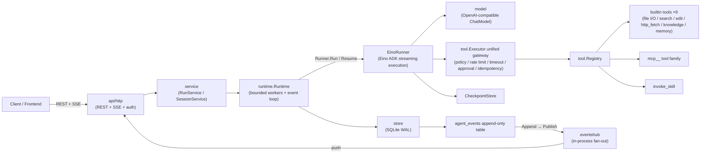

# Architecture · Overview

Rivus Agent is a **single-process** Go service: SQLite persistence, bounded worker concurrency, and CloudWeGo Eino ADK `v0.9.21` driving the agent execution loop. No external middleware — one binary plus one DB file is the entire runtime.

## Component Diagram



## Layer Responsibilities

| Directory | Responsibility |
|---|---|
| `api/http` | 21 routes (20 REST + /metrics), SSE stream (replay + push + gap backfill), Bearer auth (constant-time compare), rate-limit / security-headers / X-Request-ID / access-log middleware, owner ownership |
| `service` | RunService (create/cancel/approve/resume, budget clamping, idempotency keys), SessionService |
| `runtime` | Bounded worker event loop, budget tracker (enforced since A-E), Verifier, orphan recovery, EinoRunner wrapper (parent/child agents), parallel `tasks` sub-agents (batch ≤5, child budgets clamped to 40%), session memory injection (latest 10 entries / 8KB) |
| `domain` | State machine (`ValidTransition`), event types (28 constants), Budget/Approval/Run/Step entities |
| `tool` | Registry, unified execution gateway (per-call policy re-validation, rate limiting, timeouts, approval binding, idempotent cache, output truncation), built-in tools; tool.completed events carry args/output (1KB truncation) |
| `model` | OpenAI-compatible ChatModel factory with hot Settings lookup (3s timeout) |
| `store` | SQLite open/migrations, repositories (Task/Event/Approval/Checkpoint/Settings), MemoryRepo (session memories, LRU 100, cascade delete with session) |
| `eventshub` | In-process event fan-out (subscriber buffers; out-of-order backfill handled by the SSE layer) |
| `skill` / `mcp` | On-demand skill loading & validation (SKILL.md frontmatter + references/ files + runtime input injection) / stdio MCP server management (process-group reclaim, in-place hot refresh, 30s self-healing reconciler, 30s per-call timeout) |
| `observability` | slog logging, expvar metrics (latency histogram buckets, event append failure counter) |
| `security` | Redaction, secret reading, tenant ownership checks |
| `app` | Wiring (everything above), graceful shutdown (MCP StopAll → HTTP Shutdown → DB Close) |
| `buildinfo` | ldflags injection target for the version triple (Version/Commit/BuildDate), data source of GET /version |

## Lifecycle of One Run

```mermaid
sequenceDiagram
    participant C as Client
    participant API as api/http
    participant RS as RunService
    participant W as Runtime Worker
    participant ER as EinoRunner
    participant T as tool gateway
    participant DB as SQLite
    participant H as eventshub

    C->>API: POST /runs (budget + Idempotency-Key)
    API->>RS: CreateRun
    RS->>RS: ClampByServer + idempotency check
    RS->>DB: Run persisted queued + run.created
    RS->>W: rt.Execute (semaphore queue)
    W->>DB: run.started event
    W->>ER: Inject session memory (latest 10 / 8KB)
    W->>ER: Runner.Run (streaming + Checkpoint)
    loop Execution loop (drain)
        ER->>Model: model round
        ER->>T: tool call (policy / approval)
        T-->>ER: output (rate-limited / timed / idempotent; enriched with args/output)
        ER->>H: emit → OnEvent persisted
        H-->>C: SSE live push
    end
    alt High-risk tool
        W->>DB: waiting_approval + approval.requested
        C->>API: POST /approvals/{id} approve
        W->>ER: resume from Checkpoint
    else Budget exceeded
        W->>W: OverBudget → Runner.Cancel
        W->>DB: failed(budget_exceeded) + budget.exceeded
    else Normal completion
        W->>W: Verify(success criteria + tool evidence)
        W->>DB: succeeded/failed + run.finished/failed
    end
    W->>DB: Clean up checkpoints
```

## Key Design Decisions

| Decision | Description |
|---|---|
| Event sourcing | The `agent_events` append-only table is the single source of truth: SSE replay, audit, and budget usage all read from it |
| Unified execution gateway | Every tool call (including MCP/Skill) goes through one `Executor`: per-call policy re-validation, rate limiting, timeouts, approval binding, idempotent cache, output truncation |
| Checkpoint interrupt recovery | Eino execution state persists to SQLite; after a process restart orphan runs are marked failed and can be resumed manually |
| Budgets tightened, never relaxed | Server caps constrain client requests; the event loop enforces checks at every step (see [State Machine](state-machine.md)) |
| Bounded workers | `WORKER_CONCURRENCY` semaphore limits concurrency; `waiting_approval` occupies no worker slot |
| Idempotency key | `Idempotency-Key` returns the same Run for the same key, preventing duplicate submissions |
| Multi-tenancy | `X-Owner-ID` ownership checks; cross-owner access always 404s without leaking existence |
| Rate limiting off by default | Disabled unless `AGENT_RATE_LIMIT_RPM` is set; keyed by X-Owner-ID or source IP (LRU 1024), scoped to `/api/v1/` only, probe endpoints exempt |
| Request observability | X-Request-ID propagated or auto-generated (32-hex); structured access log records method/path/status/duration_ms/request_id |
| MCP self-healing | Failed MCP servers are retried every 30s (reconciler); each tool call has a 30s timeout to prevent hangs |
| Payload enrichment | tool.completed events merge args/output (1KB truncation each), consumed directly by the frontend tool-calls card |

Related: state machine and termination paths in [state-machine.md](state-machine.md); endpoint details in [`docs/en/api/`](../api/overview.md).
