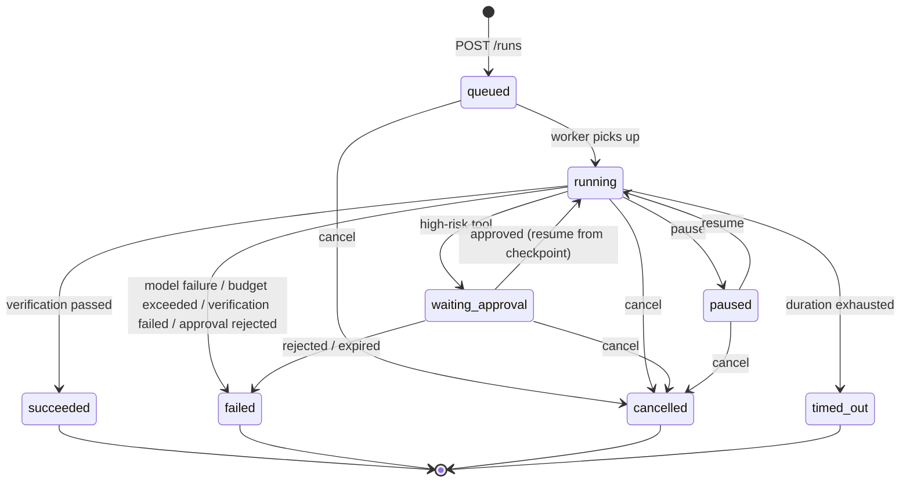

# Architecture · State Machine

The authoritative definition of the Run state machine is `ValidTransition` in [`backend/internal/domain/task.go`](../../../backend/internal/domain/task.go) — when docs and code disagree, code wins.

## States

| State | Terminal | Meaning |
|---|---|---|
| `queued` | no | Created, waiting for a worker |
| `running` | no | Executing (occupies a worker) |
| `waiting_approval` | no | High-risk tool awaiting human approval (**no worker occupied**) |
| `paused` | no | Paused (resume via API) |
| `succeeded` | yes | Verification passed |
| `failed` | yes | Failed (several `error_code` values, see below) |
| `cancelled` | yes | Cancelled by client |
| `timed_out` | yes | Duration budget exhausted |

## Transition Diagram

## Transition Table

| from | to | Trigger |
|---|---|---|
| `queued` | `running` | Worker picks up |
| `queued` | `cancelled` | `POST /runs/{id}/cancel` |
| `running` | `waiting_approval` | High-risk tool call (`approval.requested` event) |
| `running` | `paused` | Pause |
| `running` | `succeeded` | `Verify` passed |
| `running` | `failed` | Model failure / budget exceeded / verification failed / approval rejected |
| `running` | `cancelled` | cancel (takes effect after drain) |
| `running` | `timed_out` | `MaxDurationSeconds` deadline |
| `waiting_approval` | `running` | Approval approved (continues from checkpoint) |
| `waiting_approval` | `cancelled` | cancel |
| `waiting_approval` | `failed` | Approval rejected / expired |
| `paused` | `running` | `POST /runs/{id}/resume` |
| `paused` | `cancelled` | cancel |

Terminal states (last four) **cannot transition again** — cancel/resume on a terminal run returns `409 conflict`.

## Approval Flow

High-risk tools (write / external side-effect classes, including all MCP tools) require approval by default:

1. The gateway `CheckPolicy` decides approval is needed → the run enters `waiting_approval` (no worker slot occupied) + an `approval.requested` event (with `approval_id`, `tool_name`)
2. The approval record binds `args_hash` (argument digest, tamper-proof) + `expires_at` (auto-invalidated after expiry)
3. **Approve**: `POST /runs/{id}/approvals/{approval_id}` `{"approve":true}` → the run returns to `running`, resuming that tool call from the checkpoint
4. **Reject**: `{"approve":false}` → the run ends `failed`, `error_code = approval_rejected` + an `approval.decided` event
5. After a page refresh, `GET /runs/{id}/approvals` restores pending approval cards

Endpoint details: [`docs/en/api/approvals.md`](../api/approvals.md).

## Budget Exceeded Termination

Five budget dimensions (duration / model calls / tool calls / iterations / output bytes) are tightened at creation and enforced during execution:

- The event loop accumulates usage after each `model.completed` / `tool.completed` and checks `OverBudget()`, priority: **tool_calls > model_calls > output_bytes**
- On hit it calls `Runner.Cancel` to drain execution; the run ends `failed` + a `budget.exceeded` event. `error_code` mapping:

| error_code | Dimension |
|---|---|
| `tool_calls_budget_exceeded` | Tool call count |
| `model_calls_budget_exceeded` | Model call count |
| `output_bytes_budget_exceeded` | Output byte count |

- The duration dimension goes through the deadline separately: `timed_out` + a `run.timed_out` event
- Every step boundary emits a `budget.consumed` event (cumulative `model_calls` / `tool_calls` / `duration_seconds`) for frontend usage display

## Timeout Path

`MaxDurationSeconds` is implemented via a context deadline. On timeout the drain exits and the run ends `timed_out`. Note: the request context is already dead at that point, so persistence must use a background context (see the timeout branch comment in `runtime.go`).

## Orphan Recovery

On process restart (`runtime.RecoverOrphans`, executed early in startup):

- Scans up to 100 orphan runs (non-terminal when the process vanished)
- `running` → marked `failed`, `error_code = orphan_recovered` (execution interrupted by the restart; resubmit or resume manually as appropriate)
- `queued` / `paused` / `waiting_approval` stay as-is (naturally recoverable: queued waits for a worker; paused/waiting wait for API triggers)

## Verification Path

After execution ends (non-abnormal termination), `Verify` judges on two inputs: **success criteria checked one by one against the final output** + **tool evidence count**:

- Passed → `succeeded` + `verification.passed`, with the verification report written to `result_json`
- Not passed → `failed`(`verification_failed`) + `verification.failed`
- **Empty-result guard**: no success criteria, no tool evidence, and empty output → forced failure (lacks `"empty result"` evidence)
- The final output is truncated to `max_output_bytes` before verification
